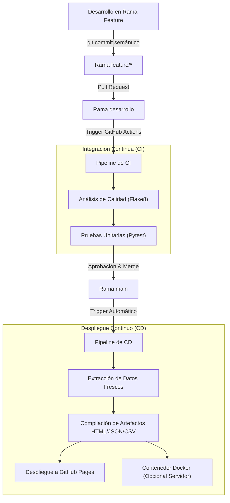

# Evidencia de Aprendizaje 2 (EA2)
## Desarrollo de Software con Git, GitHub y Flujo de Trabajo DevOps (CI/CD)

[](https://github.com/evelyncerro-iu/Cerro_Evelyn_EA2/actions/workflows/integracion_continua.yml)
[](https://github.com/evelyncerro-iu/Cerro_Evelyn_EA2/actions/workflows/despliegue_continuo.yml)


---

### Datos del Proyecto y Autoría
* **Estudiante:** Evelyn Cerro
* **Repositorio:** [https://github.com/evelyncerro-iu/Cerro_Evelyn_EA2](https://github.com/evelyncerro-iu/Cerro_Evelyn_EA2)
* **Entorno de Despliegue en Vivo:** [https://evelyncerro-iu.github.io/Cerro_Evelyn_EA2/](https://evelyncerro-iu.github.io/Cerro_Evelyn_EA2/)
* **Continuidad Académica:** Continuando con la **Evidencia de Aprendizaje 1** (`cuadernos/Cerro_Evelyn_Analizando_EA1.ipynb`), se estructura e industrializa el sistema de recolección de datos de **Diosa Bq** (`https://www.diosabq.com/`) mediante un flujo de ingeniería de software con Git, GitHub, pruebas automatizadas y despliegue continuo.

---

## 1. Objetivos del Proyecto

### 1.1 Objetivo General
Desarrollar e implementar un flujo de trabajo DevOps integral para el proyecto de software de extracción y análisis de comercio electrónico, utilizando Git y GitHub como plataforma de control de versiones y colaboración, e implementando un pipeline automatizado de Integración Continua (CI) y Despliegue Continuo (CD) con GitHub Actions que garantice la calidad del código mediante pruebas automatizadas y ejecute el despliegue continuo en un entorno web en la nube accesible, estable y de alta disponibilidad.

### 1.2 Objetivos Específicos
1. **Modularizar y Refactorizar:** Transformar el código experimental de web scraping de la Evidencia 1 (BeautifulSoup, Selenium y Scrapy) en una arquitectura modular limpia, desacoplada y orientada a objetos en Python.
2. **Control de Versiones Profesional con Git y GitHub:** Implementar una estrategia de ramificación estructurada (*GitFlow*) con ramas `main`, `desarrollo` y ramas de características, aplicando commits semánticos en español y gestión de fusiones mediante *Pull Requests*.
3. **Automatización e Integración Continua (CI):** Configurar un pipeline en GitHub Actions que ejecute análisis estático de código con *Flake8* y ejecute suites completas de pruebas unitarias con *Pytest* ante cada evento en el repositorio.
4. **Despliegue Continuo (CD):** Automatizar el empaquetado y publicación continua hacia *GitHub Pages* generando un catálogo interactivo con métricas clave, además de proporcionar contenedorización completa mediante *Docker* y *Docker Compose*.
5. **Documentar y Explicar el Flujo DevOps:** Detallar cada fase del ciclo de vida del desarrollo en la documentación técnica del repositorio para asegurar transparencia y reproducibilidad.

---

## 2. Arquitectura del Flujo de Trabajo DevOps



---

## 3. Estructura del Repositorio

```
Cerro_Evelyn_EA2/
├── .github/
│   └── workflows/
│       ├── integracion_continua.yml  # Pipeline CI: Flake8 y Pytest en matriz 3.11/3.12
│       └── despliegue_continuo.yml   # Pipeline CD: Publicación automática a GitHub Pages
├── cuadernos/
│   └── Cerro_Evelyn_Analizando_EA1.ipynb # Cuaderno de la Evidencia 1 preservado
├── datos/
│   └── muestra_productos.json        # Datos verificados de respaldo para pruebas
├── despliegue/
│   └── Dockerfile                    # Definición de contenedor ligero para producción
├── modulos/
│   ├── __init__.py
│   ├── extractor_datos.py           # Extractor desacoplado con BeautifulSoup
│   ├── transformador_datos.py       # Limpieza, conversión de moneda y exportadores
│   └── publicador_reporte.py        # Generador de dashboard interactivo responsivo
├── pruebas/
│   ├── __init__.py
│   ├── test_extractor_datos.py      # Pruebas unitarias de raspado y selectores
│   └── test_transformador_datos.py  # Pruebas unitarias de limpieza y persistencia
├── .dockerignore
├── .gitignore
├── docker-compose.yml               # Orquestación de contenedores
├── DOCUMENTACION_DEVOPS.md          # Bitácora técnica detallada de la evidencia
├── LEAME.md                         # Documentación en español
├── principal.py                     # Script CLI orquestador del flujo
├── README.md                        # Documentación principal del repositorio
└── requirements.txt                 # Dependencias del proyecto
```

---

## 4. Guía de Ejecución Local

### 4.1 Requisitos Previos
* Python 3.11 o superior.
* Git instalado y configurado.

### 4.2 Instalación del Entorno
```bash
# 1. Clonar el repositorio
git clone https://github.com/evelyncerro-iu/Cerro_Evelyn_EA2.git
cd Cerro_Evelyn_EA2

# 2. Crear y activar entorno virtual
python -m venv .venv
# En Windows:
.venv\Scripts\activate
# En Linux/macOS:
source .venv/bin/activate

# 3. Instalar dependencias
pip install -r requirements.txt
```

### 4.3 Ejecución de Pruebas y Análisis de Calidad
```bash
# Ejecutar análisis estático con Flake8 (cero errores)
python -m flake8 modulos pruebas principal.py --max-line-length=100

# Ejecutar las pruebas unitarias con Pytest
python -m pytest -v
```

### 4.4 Ejecutar el Flujo Completo
```bash
python principal.py
```
Los artefactos generados se guardarán en la carpeta `dist/`:
* `dist/index.html` (Dashboard web responsivo)
* `dist/productos.json` (Catálogo estructurado en JSON)
* `dist/productos.csv` (Catálogo en archivo separado por comas)

---

## 5. Ejecución con Docker

Para desplegar el proyecto en un entorno contenerizado aislado:

```bash
# Construir y levantar el contenedor
docker compose up --build -d

# Visualizar el sitio en el navegador
# Abra http://localhost:8080
```

---

## 6. Proceso de Desarrollo y Gestión de Versiones

1. **Ramas Principales:**
   * `main`: Producción estable y fuente de verdad.
   * `desarrollo`: Rama de integración para validar cambios antes de desplegar.
2. **Ramas de Características:**
   * `caracteristica/modularizacion-scraping-ea1`: Reestructuración del código de la Evidencia 1.
   * `caracteristica/pruebas-unitarias`: Implementación del conjunto de pruebas con Pytest.
   * `caracteristica/automatizacion-ci-cd`: Creación de los workflows de GitHub Actions y Docker.
3. **Flujo de Pull Requests:**
   Cada rama de características se integra a `desarrollo` mediante validación de CI, y los lanzamientos estables se fusionan a `main`, disparando el despliegue automático a GitHub Pages.

---

## 7. Enlaces y Entornos Desplegados

* **Sitio Web Público en Vivo (GitHub Pages):** [https://evelyncerro-iu.github.io/Cerro_Evelyn_EA2/](https://evelyncerro-iu.github.io/Cerro_Evelyn_EA2/)
* **Código Fuente y Pipelines:** [https://github.com/evelyncerro-iu/Cerro_Evelyn_EA2](https://github.com/evelyncerro-iu/Cerro_Evelyn_EA2)
* **Documentación Técnica Ampliada:** [DOCUMENTACION_DEVOPS.md](DOCUMENTACION_DEVOPS.md)
